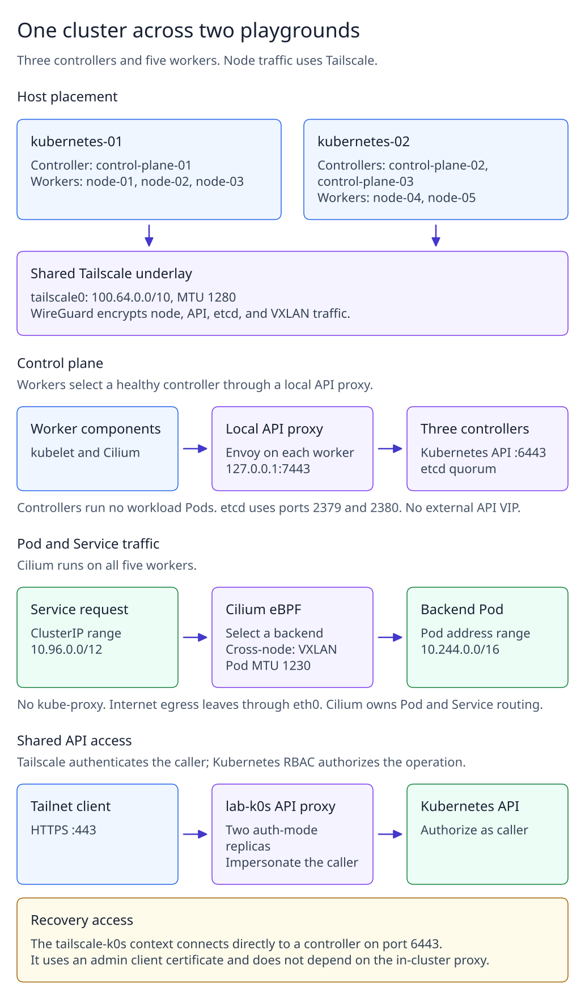
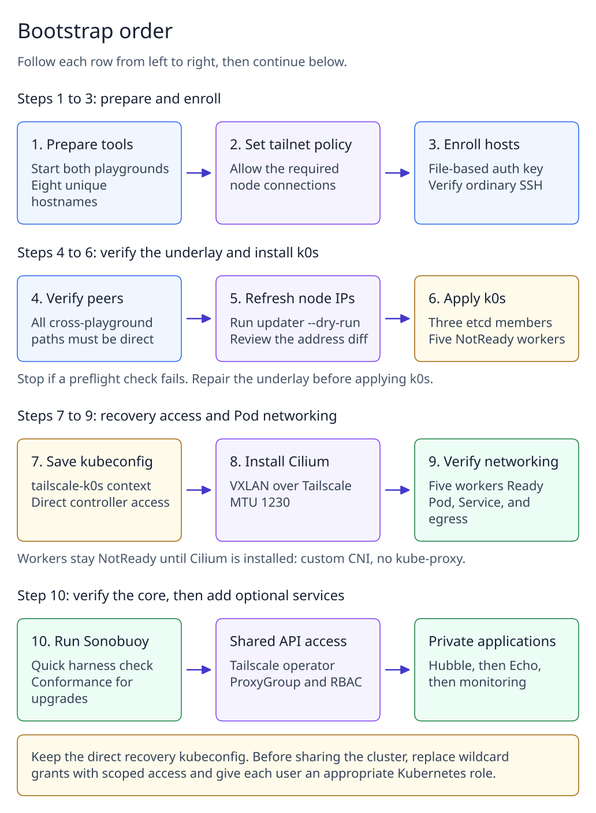
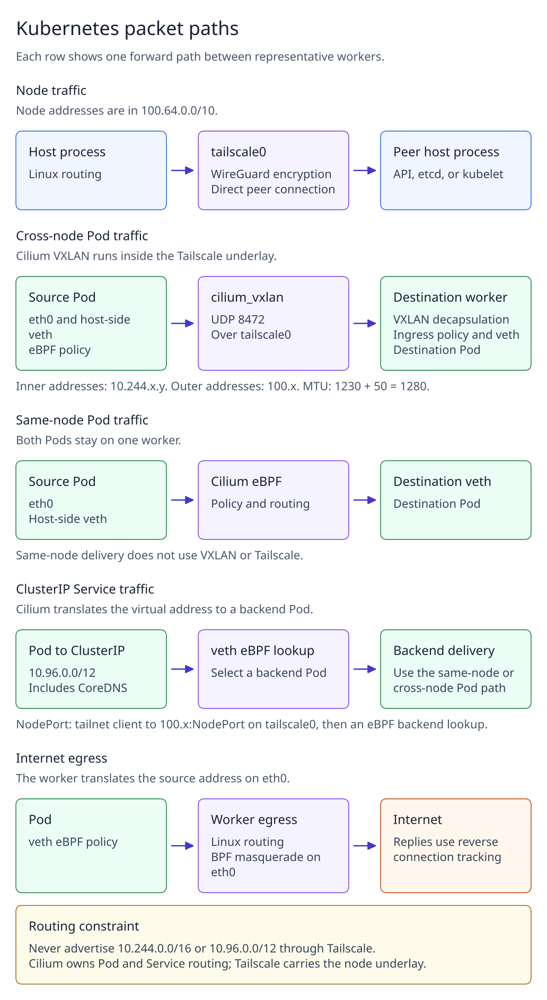
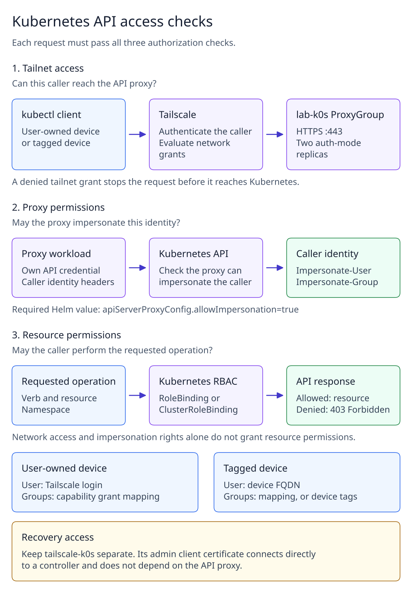
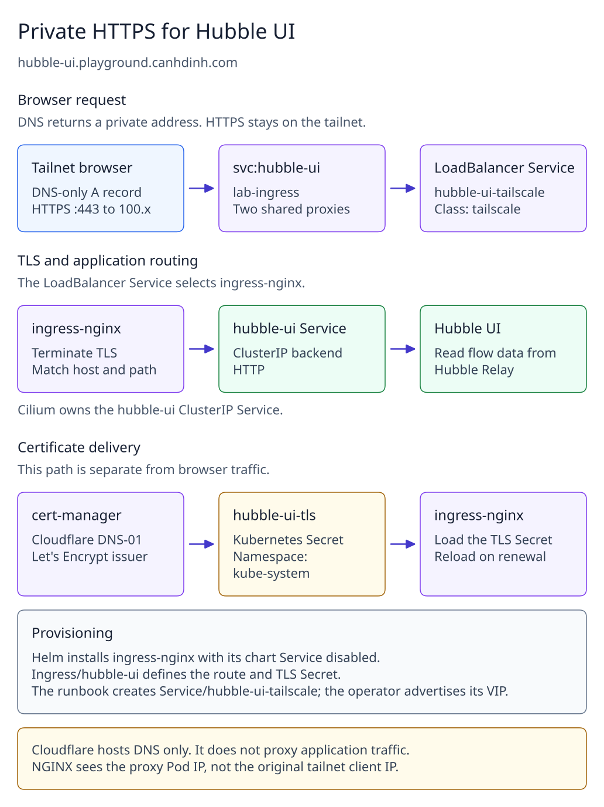
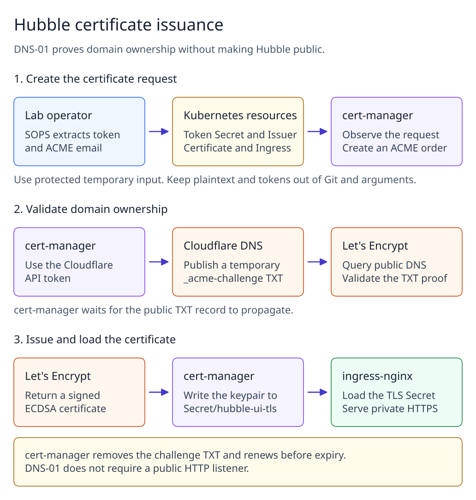
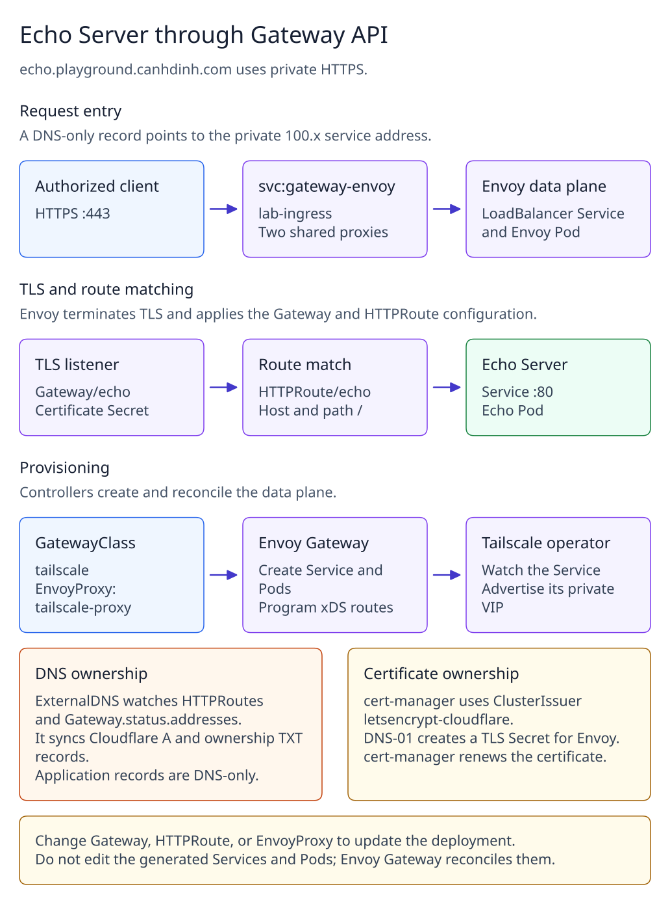
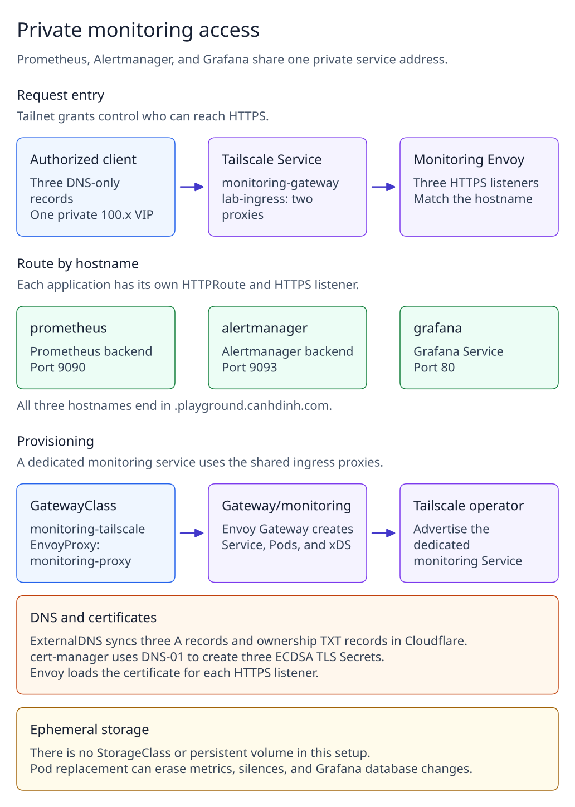

# Build and operate a k0s cluster over Tailscale

**Owner:** Lab operator | **Frequency:** As needed
**Last updated:** 2026-10-24 | **Last run:** 2026-10-24

Use this runbook to deploy and operate the eight-node Kubernetes cluster across two iximiuz Labs playgrounds. Complete Steps 1 through 10 before adding optional services.

The hosts use default Tailscale settings, file-based auth-key enrollment, and ordinary OpenSSH for administration. Preserve the direct `tailscale-k0s` recovery context when configuring proxy access.

## Choose a workflow

| Task | Follow |
| --- | --- |
| Build a new cluster | [Prerequisites](#prerequisites), then [core deployment](#core-deployment) |
| Add identity-based Kubernetes API access | [Configure identity-based API access](#configure-identity-based-api-access) |
| Expose Hubble UI | [Expose Hubble UI through Tailscale with HTTPS](#expose-hubble-ui-through-tailscale-with-https) |
| Deploy the Echo Server example | [Deploy Echo Server through Gateway API](#deploy-echo-server-through-gateway-api) |
| Deploy monitoring | [Deploy monitoring through Gateway API](#deploy-monitoring-through-gateway-api) |
| Upgrade or diagnose the cluster | [Recurring operations](#recurring-operations) and [troubleshooting](#troubleshooting) |
| Remove services or the cluster | [Rollback and safe teardown](#rollback-and-safe-teardown) |

The operator needs access to the playgrounds, tailnet, and Kubernetes cluster. Confirm the escalation contacts before maintenance.

## Purpose

The procedure joins eight Debian hosts through Tailscale and bootstraps k0s with `k0sctl`. Cilium supplies the Pod network without kube-proxy.

The cluster uses three network layers:

| Layer | Classless Inter-Domain Routing (CIDR) range or interface | Purpose |
| --- | --- | --- |
| Node underlay | `tailscale0`, `100.64.0.0/10` | Carries Secure Shell (SSH), etcd, the Kubernetes application programming interface (API), kubelet, and Virtual Extensible LAN (VXLAN) traffic |
| Pod network | `10.244.0.0/16` | Assigns one `/24` range to each worker through Cilium |
| Service network | `10.96.0.0/12` | Assigns virtual Kubernetes Service addresses |

Do not advertise the Pod or Service CIDR through a Tailscale subnet route. Tailnet clients access services through Tailscale identities instead.

## Architecture requirements

Keep these requirements true throughout the cluster lifecycle:

- Every host has a unique, stable hostname and Tailscale IPv4 address
- Every host uses the default Tailscale listener configuration
- Every host remains in one tailnet with policy-authorized peer connectivity
- `privateAddress` and `privateInterface` select `tailscale0` for k0s traffic
- `api.onlyBindToAddress: true` excludes iximiuz Labs `172.16.0.x` addresses
- Every controller name and Tailscale Internet Protocol (IP) address appears in the certificate Subject Alternative Name (SAN) list
- Pod, Service, playground local area network (LAN), and routed CIDR ranges do not overlap
- Cilium uses VXLAN because Tailscale does not route the Pod CIDR
- Workers retain Internet egress for registries and Tailscale coordination

Controllers do not run workloads. `kubectl get nodes` lists five workers. Use `k0s status` and `k0s etcd member-list` to inspect controllers.

- [Lab architecture](architecture/lab-architecture.svg): hosts, cluster components, and network boundaries
- [Bootstrap journey](architecture/bootstrap-journey.svg): ordered deployment sequence
- [Network data paths](architecture/network-data-paths.svg): node, Pod, Service, and egress packet flows
- [Private Hubble HTTPS architecture](architecture/hubble-private-https.svg): service and certificate ownership
- [DNS-01 issuance sequence](architecture/hubble-dns01.svg): certificate provisioning

The [diagram catalog](../diagrams.md#kubernetes-and-secrets) links all editable Excalidraw sources, including API access, Echo, monitoring, and secrets. Click a preview to view it at full size.

[](architecture/lab-architecture.svg)

[](architecture/bootstrap-journey.svg)

## Network data paths

The diagram uses one representative source worker and one destination worker. The same stages apply to every pair among the five workers. Controllers run no workload Pods.

[](architecture/network-data-paths.svg)

| Flow | Forward data path | Address and encapsulation behavior |
| --- | --- | --- |
| Node to node | Host process → Linux routing → `tailscale0` → peer `tailscale0` → destination host process | Uses `100.64.0.0/10` node addresses. Tailscale encrypts with WireGuard over a direct peer path. |
| Controller to controller | Controller service → `tailscale0` → peer controller | Kubernetes control traffic uses TCP `6443`; etcd client traffic uses TCP `2379`, and etcd peer quorum uses TCP `2380`. |
| Worker to controller | kubelet, Cilium, or another worker component → worker-local Envoy `127.0.0.1:7443` → selected controller `100.x:6443` over `tailscale0` | k0s node-local load balancing retries healthy controllers. It provides in-cluster API availability, not an external virtual IP. |
| Pod to same node | Pod `eth0` → host-side veth → source Cilium eBPF policy and routing → destination endpoint eBPF policy → destination veth | The packet keeps Pod IP addresses and never enters `cilium_vxlan` or `tailscale0`. |
| Pod to another node | Pod `eth0` → veth eBPF → `cilium_vxlan` encapsulation → UDP `8472` with remote `100.x` node destination → `tailscale0` → remote VXLAN decapsulation → ingress policy → destination veth | Inner source and destination remain `10.244.x.y`. VXLAN adds 50 bytes; Tailscale encrypts the outer node packet. Cilium MTU `1230` fits inside `tailscale0` MTU `1280`. |
| Pod to node process | Pod `eth0` → veth eBPF → host routing → local node socket, or VXLAN/Tailscale first when the node is remote | Cilium applies endpoint policy before host delivery. Host-network traffic is outside the Pod veth path. |
| Pod to ClusterIP Service | Pod → veth eBPF Service lookup → selected backend Pod → same-node or cross-node Pod path | `10.96.0.0/12` is virtual and is never routed through Tailscale. With `socketLB.hostNamespaceOnly: true`, Pod namespaces use the tc eBPF load balancer on the veth. |
| Tailnet client to Kubernetes API | Client → Tailscale Service HTTPS `443` → one API ProxyGroup Pod → API server `6443` | In auth mode, the proxy derives impersonation headers from Tailscale identity; Kubernetes RBAC makes the authorization decision. The direct client-certificate context remains the recovery path. |
| Tailnet client to NodePort | Client → node `100.x:NodePort` on `tailscale0` → Cilium eBPF Service lookup → local or remote backend | `nodePort.directRoutingDevice: tailscale0` selects the ingress device. The default Cilium load-balancer mode is SNAT; remote backends then use the cross-node path. |
| Pod to Internet | Pod → veth eBPF policy → Linux route → BPF masquerade on `eth0` → Internet | Cilium changes the source Pod IP to the worker `eth0` address. The reply is reverse-translated through BPF connection tracking and delivered to the Pod. |
| Pod DNS lookup | Pod → CoreDNS ClusterIP → Cilium Service lookup → selected CoreDNS Pod | Backend delivery follows the same-node or cross-node Pod path. No Layer 7 DNS proxy is in the path unless a Cilium DNS policy requires it. |

Reply packets traverse the corresponding stages in reverse. Cilium connection tracking restores Service and masquerade translations; a cross-node reply is independently VXLAN-encapsulated and WireGuard-encrypted between the two worker Tailscale addresses.

Do not advertise `10.244.0.0/16` or `10.96.0.0/12` as Tailscale subnet routes. Cilium owns those ranges, while Tailscale carries only the node underlay and explicitly exposed Tailscale Services.

## Current versions

Test upgrades in a fresh playground before changing a shared cluster.

| Component | Version |
| --- | --- |
| k0sctl | `v0.33.1` |
| k0s and Kubernetes | `v1.36.4+k0s.1` |
| Cilium | `v1.20.4` |
| Tailscale clients | `1.104.2` |
| Tailscale Kubernetes Operator | chart and operator `1.104.2` |
| cert-manager | `v1.21.3` |
| ingress-nginx | chart `4.15.1`, controller `v1.15.1` |
| Envoy Gateway | `v1.9.2`, Envoy Proxy `v1.39.5` |
| ExternalDNS | chart `1.23.0`, controller `v0.24.0` |
| Echo Server | `0.9.2` |
| kube-prometheus-stack | chart `92.11.0`, Prometheus Operator `v0.94.2` |
| Prometheus | `v3.15.1` |
| Grafana | `13.2.4` |
| Alertmanager | `v0.34.1` |
| Sonobuoy | `v0.57.5` |

The repository pins client tools in [`../../mise.toml`](../../mise.toml). The ExternalDNS and monitoring values files pin controller, Prometheus, and config-reloader patches newer than their charts' defaults. Both EnvoyProxy manifests pin the latest security patch in Envoy Gateway's supported Envoy 1.39 series.

## Prerequisites

Complete every prerequisite before changing the cluster:

- [ ] Start both playgrounds from the repository [deployment guide](../../README.md)
- [ ] Obtain administrator access to the Tailscale tailnet
- [ ] Connect the control host to the same tailnet
- [ ] Obtain SSH root access to all eight hosts
- [ ] Configure SOPS access for `secrets/lab.sops.yaml`
- [ ] Install `mise`, `uv`, Tailscale, and the repository tools
- [ ] Confirm that no accepted route overlaps the Pod or Service CIDR
- [ ] Schedule an outage and back up data before disruptive changes

The machine hostnames must match [`k0s.yaml`](k0s.yaml):

```text
control-plane-01  control-plane-02  control-plane-03
node-01           node-02           node-03  node-04  node-05
```

## Core deployment

Follow Steps 1 through 10 in order for a new deployment. For later changes, use the matching recurring operation and preserve the architecture requirements.

### Step 1: Prepare the control host

Install the pinned tools, validate the enrollment playbook, and run the address-updater tests from the repository root. Run all Ansible commands below from this directory:

```bash
mise install
mise ls --local
ansible-playbook --version
ansible-lint --version
ansible-lint \
  ansible/tailscale.yml \
  ansible/roles/tailscale_enrollment
ansible-playbook \
  -i ansible/inventories/kubernetes.ini \
  ansible/tailscale.yml --syntax-check
uv sync --locked
uv run --locked python -m unittest \
  scripts/test_update_k0s_tailscale_ips.py -v
```

**Expected result:** Both Ansible version commands succeed, the enrollment playbook passes lint and syntax checks, and the address-updater tests pass.

**If it fails:** Resolve missing tool versions or Python dependencies before continuing. Do not bootstrap with an untested updater.

### Step 2: Configure the tailnet policy

Create a policy from [`tailnet-policy.hujson`](tailnet-policy.hujson). Replace `tailscale_login` with the login from `tailscale status`.

The example retains this personal lab's wildcard grant. That grant allows every source to reach every destination. It also makes the narrower API grant redundant for network authorization.

Before inviting another member, replace the wildcard with reviewed grants for:

- Administrator access
- Cluster ports between the eight user-owned Kubernetes node addresses
- The `tag:k8s` API endpoint

An empty tag-owner list restricts assignment to administrator auth keys or scoped operator credentials. The Service approvers cover the four named API and application Services rather than every Service.

The shared policy retains `tag:lab` and Tailscale SSH rules for Incus. Kubernetes hosts use no tags and ordinary OpenSSH; their access depends on network grants and SSH keys.

**Expected result:** The Tailscale policy editor accepts the policy without warnings.

**If it fails:** Validate the login, tags, and HuJSON syntax. Do not weaken the policy to bypass validation.

### Step 3: Enroll every playground machine

Use the shared enrollment workflow with both current playground run IDs:

```bash
ansible-playbook \
  -i ansible/inventories/kubernetes.ini \
  ansible/tailscale.yml \
  -e kubernetes_01_play_id=playground_run_id_1 \
  -e kubernetes_02_play_id=playground_run_id_2
```

The role decrypts only `tailscale.access_token`, which must belong to a tailnet administrator. It creates a reusable, preauthorized one-hour auth key and transfers it using protected files. After enrolling disconnected nodes, it removes the files and revokes the key.

For the Kubernetes inventory, the role runs `tailscale up --auth-key=file:/run/tailscale-auth-key` with no other options. Incus retains tagged enrollment and Tailscale SSH. If enrollment is interrupted, revoke the temporary key and remove `/run/tailscale-auth-key` from all eight hosts before retrying.

Plain `tailscale up` does not enable Tailscale SSH. Verify ordinary OpenSSH administrator access over each node's Tailscale address before running `k0sctl`. Use `labctl` to configure SSH access if needed.

If this tailnet previously contained machines with the same hostnames, remove those stale device records before enrollment. Duplicate names receive suffixed MagicDNS names such as `node-01-1`, and the address updater intentionally rejects duplicate hostnames. Delete only records confirmed offline and belonging to destroyed playground sessions; never remove a live or unrelated device to make validation pass. Allow MagicDNS to converge before reusing canonical names.

Never put auth-key values in command arguments, logs, or tracked plaintext files. Do not enable `--accept-routes` or other non-default node options.

**Expected result:** `tailscale status` shows eight online, user-owned devices with their canonical hostnames.

**If it fails:** Check API access, key revocation, device approval, `labctl` access, node time, and Tailscale connectivity.

### Step 4: Verify the Tailscale underlay

Confirm peer discovery and SSH access from the control host:

```bash
tailscale status
tailscale ping control-plane-01
tailscale ping control-plane-02
tailscale ping control-plane-03
tailscale ping node-01
ssh root@control-plane-01 hostname
ssh root@node-01 hostname
```

Inspect one controller and one worker:

```bash
ssh root@control-plane-01 \
  'tailscale status; tailscale netcheck; ip -br addr show tailscale0'
ssh root@node-01 \
  'tailscale status; tailscale netcheck; ip -br addr show tailscale0'
```

Check cluster routes on the control host and every node:

```bash
(
  set -euo pipefail
  hosts=(control-plane-01 control-plane-02 control-plane-03 \
    node-01 node-02 node-03 node-04 node-05)
  ip route get 10.244.0.1
  ip route get 10.96.0.1
  for host in "${hosts[@]}"; do
    ssh root@"$host" \
      'ip route get 10.244.0.1; ip route get 10.96.0.1'
  done
)
```

Before Cilium installation, neither address may use another virtual private network (VPN) or subnet router.

Verify every host path between the two playgrounds is direct before
bootstrapping k0s:

```bash
(
  set -euo pipefail
  left=(control-plane-01 node-01 node-02 node-03)
  right=(control-plane-02 control-plane-03 node-04 node-05)
  for source in "${left[@]}"; do
    for target in "${right[@]}"; do
      ssh root@"$source" \
        tailscale ping --timeout=20s --until-direct=true "$target"
    done
  done
)
```

Tailscale uses its default UDP listener and discovers external mappings through Session Traversal Utilities for NAT (STUN) and NAT traversal. Keep that default on every host. Allow discovery to converge and repeat the full probe before diagnosing failed paths. Investigate playground NAT and placement without adding port overrides or custom Tailscale firewall rules.

**Expected result:** Every peer responds, hostnames are unique, `tailscale0` has a `100.x` address, and every cross-playground probe reports a public `IP:port` endpoint rather than DERP.

**If it fails:** Stop the deployment. Resolve missing peers, duplicate hostnames, relayed paths, or route overlap first.

### Step 5: Populate Tailscale addresses

Discover tailnet-specific addresses and preview the change:

```bash
uv run scripts/update_k0s_tailscale_ips.py --dry-run
uv run scripts/update_k0s_tailscale_ips.py
git diff -- docs/k0s/k0s.yaml
```

The updater requires every configured hostname to be online. It rejects duplicate names, reused addresses, and addresses outside `100.64.0.0/10`.

The updater changes only these values:

- Each host's `ssh.address`
- Each host's `privateAddress`
- Controller IPs in the API certificate SAN list

**Expected result:** The diff changes only the listed address fields.

**If it fails:** Restore connectivity or correct duplicate identities. Do not manually bypass updater validation.

### Step 6: Validate and bootstrap k0s

Inspect the generated configuration before applying it:

```bash
k0sctl apply --config docs/k0s/k0s.yaml --dry-run
```

Each controller's `spec.api.address` must use its Tailscale IP. Join validation must not use an iximiuz Labs `172.16.0.x` address.

Apply the validated configuration:

```bash
k0sctl apply --config docs/k0s/k0s.yaml
```

`spec.options.wait.enabled` remains `false`. Workers stay `NotReady` until Cilium starts because k0s uses a custom Container Network Interface (CNI).

Validate the control plane and etcd membership:

```bash
(
  set -euo pipefail
  for attempt in {1..24}; do
    members=$(ssh root@control-plane-01 k0s etcd member-list)
    nodes=$(ssh root@control-plane-01 \
      'k0s kubectl get nodes --no-headers' 2>/dev/null || true)
    [[ $(jq '.members | length' <<<"$members") -eq 3 ]] &&
      [[ $(wc -l <<<"$nodes") -eq 5 ]] && break
    sleep 5
  done
  [[ $(jq '.members | length' <<<"$members") -eq 3 ]]
  [[ $(wc -l <<<"$nodes") -eq 5 ]]
)
ssh root@control-plane-01 k0s status
ssh root@control-plane-02 k0s status
ssh root@control-plane-03 k0s status
ssh root@control-plane-01 k0s etcd member-list
ssh root@control-plane-01 k0s kubectl get nodes -o wide
```

**Expected result:** etcd lists three controller Tailscale addresses. Kubernetes lists five `NotReady` workers with `100.x` InternalIP values.

**If it fails:** Check `api.onlyBindToAddress: true`. Inspect the selected API address, then reconcile with `k0sctl`:

```bash
ssh root@control-plane-01 \
  "journalctl -u k0scontroller --no-pager | grep 'using api address'"
k0sctl apply --config docs/k0s/k0s.yaml --dry-run
k0sctl apply --config docs/k0s/k0s.yaml
```

### Step 7: Configure recovery API access

Create a protected admin kubeconfig. Back up an existing file, then replace the
old `tailscale-k0s` cluster, context, and dedicated user before merging so
`kubectl` cannot retain stale credentials from an earlier playground:

```bash
(
  set -euo pipefail
  mkdir -p ~/.kube
  if [[ -f ~/.kube/config ]]; then
    cp --backup=numbered --preserve=mode,timestamps \
      ~/.kube/config ~/.kube/config.pre-k0s
  fi

  tmp_kubeconfig=$(mktemp)
  base_kubeconfig=$(mktemp)
  merged_kubeconfig=$(mktemp)
  trap 'rm -f "$tmp_kubeconfig" "$base_kubeconfig" \
    "$merged_kubeconfig"' EXIT
  chmod 600 "$tmp_kubeconfig" "$base_kubeconfig" "$merged_kubeconfig"
  k0sctl kubeconfig --config docs/k0s/k0s.yaml \
    --cluster tailscale-k0s --user tailscale-k0s-admin >"$tmp_kubeconfig"

  if [[ -f ~/.kube/config ]]; then
    cp ~/.kube/config "$base_kubeconfig"
    KUBECONFIG="$base_kubeconfig" kubectl config delete-context \
      tailscale-k0s >/dev/null 2>&1 || true
    KUBECONFIG="$base_kubeconfig" kubectl config delete-cluster \
      tailscale-k0s >/dev/null 2>&1 || true
    KUBECONFIG="$base_kubeconfig" kubectl config delete-user \
      tailscale-k0s-admin >/dev/null 2>&1 || true
    KUBECONFIG="$base_kubeconfig:$tmp_kubeconfig" \
      kubectl config view --flatten >"$merged_kubeconfig"
  else
    cp "$tmp_kubeconfig" "$merged_kubeconfig"
  fi

  KUBECONFIG="$merged_kubeconfig" kubectl config get-contexts \
    tailscale-k0s >/dev/null
  install -m 600 "$merged_kubeconfig" ~/.kube/config
)

kubectl config use-context tailscale-k0s
kubectl config current-context
kubectl get --raw=/readyz
```

This kubeconfig contains a privileged client certificate. It connects directly to the first controller, so protect it as a recovery credential.

The design has no external virtual IP. Every controller address appears in the certificate SAN list. During recovery, an administrator can point the kubeconfig at another controller.

Do not set `spec.api.externalAddress` with k0s node-local load balancing. k0s does not support that combination.

**Expected result:** The context is `tailscale-k0s`, and `/readyz` returns `ok`.

**If it fails:** Confirm controller health, certificate SAN entries, Tailscale routes, and file permissions.

### Step 8: Install Cilium

Install Cilium with the checked-in values:

```bash
cilium install \
  --version 1.20.4 \
  --values docs/k0s/cilium-values.yaml
cilium status --wait
```

These settings bind Cilium to the Tailscale underlay:

- `k8sServiceHost: 127.0.0.1` and port `7443` use the worker-local API proxy
- `nodePort.directRoutingDevice: tailscale0` selects the node underlay
- `devices: [eth0, tailscale0]` selects the stable lab interfaces
- `routingMode: tunnel` and `tunnelProtocol: vxlan` tunnel Pod traffic
- `MTU: 1230` fits VXLAN within Tailscale's `1280` byte maximum transmission unit (MTU)
- `socketLB.hostNamespaceOnly: true` supports Tailscale operator proxy Pods

The configuration omits optional Layer 7 routing and encryption features. Tailscale encrypts the node underlay.

Hubble Relay may warn that its server listener lacks Transport Layer Security (TLS). The `ClusterIP` Service limits Relay access to the Hubble user interface (UI). Configure server TLS and client authentication before external exposure.

Do not raise the Pod MTU without measurements across every node pair. Encapsulation errors can stall large requests while health checks pass.

**Expected result:** `cilium status --wait` reports healthy agents and operators.

**If it fails:** Check the API proxy, selected devices, MTU, image pulls, and Cilium Pod logs.

### Step 9: Verify cluster networking

Check node readiness and system workloads:

```bash
kubectl get nodes -o wide
kubectl -n kube-system get pods -o wide
kubectl -n kube-system get daemonset kube-proxy
cilium status --wait
```

Run focused connectivity tests after bootstrap, network changes, and Cilium upgrades:

```bash
(
  set -euo pipefail
  context=tailscale-k0s
  trap 'cilium connectivity test --context "$context" --cleanup' EXIT

  cilium connectivity test \
    --context "$context" \
    --hubble=false \
    --ip-families ipv4 \
    --test '^no-policies/' \
    --test '^client-egress/' \
    --flow-validation disabled \
    --junit-file /tmp/cilium-connectivity-junit.xml \
    --timeout 15m
)
```

The selectors test Pod traffic, ClusterIP and NodePort Services, Domain Name System (DNS), and client egress. They omit the `dns-only` Layer 7 test because this cluster has no Envoy proxy. `cilium status --wait` verifies Relay deployment health separately. The traffic suite disables Hubble because flow validation is disabled; traffic test failures remain fatal.

Always run cleanup after a failed or interrupted test. The tested configuration executes 70 actions.

Inspect the effective MTU and peer path:

```bash
ssh root@node-01 ip -d link show tailscale0
ssh root@node-01 ip -d link show cilium_vxlan
kubectl -n kube-system exec daemonset/cilium -- \
  cilium-dbg status --verbose | grep -i mtu
ssh root@node-01 tailscale ping node-02
```

Confirm the cross-playground worker paths remain direct with repeated probes:

```bash
(
  set -euo pipefail
  left=(node-01 node-02 node-03)
  right=(node-04 node-05)
  for attempt in 1 2 3; do
    for source in "${left[@]}"; do
      for target in "${right[@]}"; do
        ssh root@"$source" \
          tailscale ping --timeout=10s --until-direct=true "$target"
      done
    done
  done
)
```

Every response must report a public `IP:port` endpoint. Treat any DERP response
or failure to establish a direct connection as a failed underlay check.

**Expected result:** Five workers are `Ready`. System Pods run, kube-proxy is absent, `tailscale0` reports MTU `1280`, and Cilium routes report MTU `1230`.

**If it fails:** Run cleanup, retain the JUnit file, and use the troubleshooting table before changing configuration.

### Step 10: Run Kubernetes conformance tests

Install Sonobuoy for end-to-end (e2e) tests without changing repository pins:

```bash
mise install sonobuoy@0.57.5
mise exec sonobuoy@0.57.5 -- sonobuoy version
```

After bootstrap, run Sonobuoy's `quick` mode to validate the harness:

```bash
(
  set -euo pipefail
  context=tailscale-k0s
  trap 'mise exec sonobuoy@0.57.5 -- sonobuoy \
    --context "$context" delete --wait' EXIT

  mise exec sonobuoy@0.57.5 -- sonobuoy \
    --context "$context" run --mode quick --wait
  results=$(mise exec sonobuoy@0.57.5 -- sonobuoy \
    --context "$context" retrieve /tmp)
  mise exec sonobuoy@0.57.5 -- sonobuoy results "$results"
)
```

Before a Kubernetes, k0s, or Cilium upgrade, run the non-disruptive profile. This lab completes it in about two hours:

```bash
(
  set -euo pipefail
  context=tailscale-k0s
  trap 'mise exec sonobuoy@0.57.5 -- sonobuoy \
    --context "$context" delete --all --wait' EXIT

  mise exec sonobuoy@0.57.5 -- sonobuoy \
    --context "$context" run \
    --mode non-disruptive-conformance --wait
  results=$(mise exec sonobuoy@0.57.5 -- sonobuoy \
    --context "$context" retrieve /tmp)
  mise exec sonobuoy@0.57.5 -- sonobuoy results "$results"
)
```

Run certification only on an empty cluster with backups and an outage window:

```bash
(
  set -euo pipefail
  context=tailscale-k0s
  trap 'mise exec sonobuoy@0.57.5 -- sonobuoy \
    --context "$context" delete --all --wait' EXIT

  mise exec sonobuoy@0.57.5 -- sonobuoy \
    --context "$context" run --mode certified-conformance --wait
  results=$(mise exec sonobuoy@0.57.5 -- sonobuoy \
    --context "$context" retrieve /tmp)
  sha256sum "$results"
  mise exec sonobuoy@0.57.5 -- sonobuoy results "$results"
)
```

Check the [latest maintenance results](#latest-maintenance) before treating this cluster as conformant.

**Expected result:** The selected profile reports zero failed e2e tests and five passing log plugins.

**If it fails:** Preserve the archive and inspect every failure. A passing isolated rerun does not replace the failed full-run result.

## Optional services

Install only the services your environment needs. Complete the core deployment and verification first.

The procedures are cumulative. Identity-based API access installs the Tailscale
operator. Hubble HTTPS adds the shared ingress ProxyGroup, cert-manager, and
ingress-nginx. Echo adds Envoy Gateway, Gateway API support, and ExternalDNS.
Monitoring reuses all of those shared components. Follow that order, stopping
after the last service you need.

### Configure identity-based API access

Use the direct kubeconfig for bootstrap and recovery. Install the Tailscale Kubernetes Operator when shared access needs Tailscale identity and Kubernetes role-based access control (RBAC).

The tailnet policy must include `tag:k8s-operator`, `tag:k8s`, grants, and the Service approver. Enable Hypertext Transfer Protocol Secure (HTTPS) on the [Tailscale DNS settings page](https://login.tailscale.com/admin/dns).

Create an Open Authorization (OAuth) client with `tag:k8s-operator` and these write scopes:

- General / Services
- Devices / Core
- Keys / Auth Keys

Store the values in the encrypted secrets file:

```yaml
tailscale:
  access_token: tailscale_api_access_token
  oauth:
    client_id: tailscale_operator_oauth_client_id
    client_secret: tailscale_operator_oauth_client_secret
  kubernetes_user: tailscale_login
```

Edit secrets only with `sops secrets/lab.sops.yaml`. Disable shell tracing before handling credentials.

Create the namespace:

```bash
kubectl --context tailscale-k0s create namespace tailscale \
  --dry-run=client -o yaml | \
  kubectl --context tailscale-k0s apply -f -
```

Create the OAuth Secret without exposing credentials in command arguments:

```bash
(
  set -e
  if [[ $- == *x* ]]; then
    printf 'Disable shell tracing before handling OAuth credentials.\n' >&2
    exit 1
  fi
  oauth_dir=$(mktemp -d)
  chmod 700 "$oauth_dir"
  trap 'rm -rf "$oauth_dir"' EXIT
  umask 077
  sops decrypt --extract \
    '["tailscale"]["oauth"]["client_id"]' \
    secrets/lab.sops.yaml >"$oauth_dir/client_id"
  sops decrypt --extract \
    '["tailscale"]["oauth"]["client_secret"]' \
    secrets/lab.sops.yaml >"$oauth_dir/client_secret"

  kubectl --context tailscale-k0s -n tailscale \
    create secret generic operator-oauth \
    --from-file=client_id="$oauth_dir/client_id" \
    --from-file=client_secret="$oauth_dir/client_secret" \
    --dry-run=client -o yaml | \
    kubectl --context tailscale-k0s apply -f -
)
```

Kubernetes Secrets need API-server encryption for encryption at rest. Use an external secret controller when the environment provides one.

Install the operator:

```bash
helm upgrade --install tailscale-operator \
  tailscale-operator \
  --repo https://pkgs.tailscale.com/helmcharts \
  --version 1.104.2 \
  --namespace tailscale \
  --set-string apiServerProxyConfig.allowImpersonation=true \
  --wait
kubectl --context tailscale-k0s -n tailscale \
  rollout status deployment/operator --timeout=5m
```

Create a two-replica API proxy:

```bash
kubectl --context tailscale-k0s apply -f - <<'YAML'
apiVersion: tailscale.com/v1alpha1
kind: ProxyGroup
metadata:
  name: lab-k0s
spec:
  type: kube-apiserver
  replicas: 2
  kubeAPIServer:
    mode: auth
    hostname: lab-k0s
YAML

kubectl --context tailscale-k0s wait proxygroup/lab-k0s \
  --for=condition=ProxyGroupReady=true \
  --timeout=5m
```

The URL follows `https://lab-k0s.tailnet_dns_name.ts.net`.

#### Understand identity impersonation

The API proxy in `auth` mode converts a Tailscale identity into a Kubernetes identity. It does not issue each tailnet user a Kubernetes client certificate, and reaching the proxy does not grant Kubernetes permissions.

[](architecture/api-impersonation.svg)

The [impersonation diagram](architecture/api-impersonation.svg) separates tailnet access, proxy impersonation rights, and resource authorization into three numbered checks.

Each request crosses three independent authorization boundaries:

1. Tailscale authenticates the calling user or tagged device. Tailnet grants decide whether that identity can reach the proxy on HTTPS port `443`.
2. The ProxyGroup authenticates to the Kubernetes API with its own workload credential and forwards `Impersonate-User` and, when applicable, `Impersonate-Group` headers. Kubernetes verifies that the ProxyGroup may impersonate those identity categories.
3. Kubernetes evaluates the requested verb and resource as the impersonated user and groups. A matching `RoleBinding` or `ClusterRoleBinding` permits the operation; otherwise the API returns `403 Forbidden`.

The request therefore carries two identities:

| Identity | Meaning | Authorization purpose |
| --- | --- | --- |
| ProxyGroup transport identity | The proxy workload that authenticated to the API server | Must be allowed to impersonate users and groups |
| Effective identity | The Tailscale user, device, and mapped groups in the impersonation headers | Must be allowed to perform the requested Kubernetes operation |

The Helm value `apiServerProxyConfig.allowImpersonation=true` provisions the operator RBAC for the first Kubernetes check. It does not grant the effective user access to resources. The later `tailscale-lab-k0s-admin` binding grants the owner’s Tailscale login its Kubernetes role.

The proxy derives headers from the caller:

| Tailscale caller | `Impersonate-User` | `Impersonate-Group` |
| --- | --- | --- |
| User-owned device | Tailscale login, such as `alice@example.com` | Groups supplied by matching Tailscale Kubernetes capability grants, when configured |
| Tagged device | Device fully qualified domain name (FQDN) | Groups supplied by matching capability grants; without those grants, the device tags are used as groups |

This lab currently binds the owner login directly as a Kubernetes user. The checked-in tailnet policy grants network access to `tag:k8s` but does not map a Tailscale group to a Kubernetes group. For shared access, prefer a purpose-specific group such as `tailnet-readers`, map it with a Tailscale Kubernetes capability grant, and bind that group to `view` or a namespace-scoped role. Do not map routine users to `system:masters`.

Verify the effective identity and authorization result through the proxy context:

```bash
proxy_context=$(kubectl config get-contexts -o name | \
  grep '^lab-k0s\..*\.ts\.net$')
kubectl --context "$proxy_context" auth whoami
kubectl --context "$proxy_context" auth can-i get pods --all-namespaces
```

Keep the direct `tailscale-k0s` context separate. It uses a privileged Kubernetes client certificate rather than Tailscale impersonation and remains the recovery path.

If readiness stalls, inspect the advertised Service:

```bash
kubectl --context tailscale-k0s get proxygroup lab-k0s -o jsonpath='\
{range .status.conditions[*]}{.type}{"="}{.status}{": "}\
{.message}{"\n"}{end}'
```

The exact `svc:lab-k0s` auto-approver should approve both backends. Reconcile both exact backend approvals through the API as an idempotent check:

```bash
(
  set -euo pipefail
  token=$(sops decrypt --extract \
    '["tailscale"]["access_token"]' secrets/lab.sops.yaml)
  trap 'unset token' EXIT
  api='https://api.tailscale.com/api/v2/tailnet/-/services'
  hosts=$(curl --fail-with-body --silent --show-error \
    -H "Authorization: Bearer $token" \
    "$api/svc%3Alab-k0s/devices")
  node_ids_json=$(jq -cer '
    if (.hosts | length) == 2 and
       all(.hosts[]; .nodeId | type == "string" and length > 0)
    then [.hosts[].nodeId]
    else error("expected exactly two API proxy backends") end
  ' <<<"$hosts")
  while IFS= read -r node_id; do
    curl --fail-with-body --silent --show-error \
      --request POST \
      -H "Authorization: Bearer $token" \
      -H 'Content-Type: application/json' \
      --data '{"approved":true}' \
      "$api/svc%3Alab-k0s/device/${node_id}/approved" >/dev/null
  done < <(jq -r '.[]' <<<"$node_ids_json")
)
```

Rotate or revoke the owner-scoped API token after all optional-service
approvals and teardown operations that need it are complete. Tailscale API
tokens expire within 90 days.

Grant the owner administrator access without printing the identity:

```bash
(
  set -euo pipefail
  kubernetes_user=$(sops decrypt --extract \
    '["tailscale"]["kubernetes_user"]' secrets/lab.sops.yaml)
  trap 'unset kubernetes_user' EXIT

  kubectl --context tailscale-k0s create clusterrolebinding \
    tailscale-lab-k0s-admin \
    --clusterrole=cluster-admin \
    --user="$kubernetes_user" \
    --dry-run=client -o yaml | \
    kubectl --context tailscale-k0s apply -f -
)
```

Create separate `view` or namespace-scoped bindings for guests. Never add a guest login to the owner binding.

Configure the client and verify its identity:

```bash
proxy_url=$(kubectl --context tailscale-k0s get proxygroup lab-k0s \
  -o jsonpath='{.status.url}')
tailscale configure kubeconfig "$proxy_url"
proxy_context=$(kubectl config get-contexts -o name | \
  grep '^lab-k0s\..*\.ts\.net$')
kubectl --context "$proxy_context" auth whoami
kubectl --context "$proxy_context" get nodes
```

Keep the direct `tailscale-k0s` context. It remains the recovery path when cluster DNS, Cilium, or ProxyGroup fails.

**Expected result:** `ProxyGroupReady` is true. Two proxy Pods run on different workers, and `kubectl auth whoami` reports the Tailscale login.

**If it fails:** Check operator logs, Service approval, OAuth scopes, tailnet HTTPS, RBAC bindings, and Pod placement.

### Expose Hubble UI through Tailscale with HTTPS

Hubble Relay and Hubble UI are enabled by [`cilium-values.yaml`](cilium-values.yaml). Install cert-manager and ingress-nginx to terminate browser-trusted TLS without changing Cilium's Helm-owned `hubble-ui` ClusterIP Service:

[](architecture/hubble-private-https.svg)

The request and certificate paths are separate. Cloudflare hosts the public DNS records for the custom hostname and ACME validation but does not proxy Hubble UI traffic. The DNS-only `A` record returns a private Tailscale address. A policy-authorized tailnet client connects through the Tailscale Service to ingress-nginx, which terminates TLS and forwards HTTP to Cilium's `hubble-ui` Service.

#### How ingress-nginx and its load balancer are provisioned

This deployment separates the ingress controller from its external entry point:

| Resource | Owner and effect |
| --- | --- |
| ingress-nginx Helm release | Installs `IngressClass/nginx`, the controller `Deployment`, admission webhook, RBAC, and controller `ConfigMap`. `controller.service.enabled=false` prevents the chart from creating its usual public-facing Service. |
| `Ingress/hubble-ui` | Declares host and path routing. The controller resolves the `hubble-ui` endpoints, reads `Secret/hubble-ui-tls`, and renders the NGINX configuration. |
| `ProxyGroup/lab-ingress` | Maintains two shared ingress proxy Pods. |
| `Service/ingress-nginx/hubble-ui-tailscale` | Selects the ingress-nginx controller, uses `type: LoadBalancer` and `loadBalancerClass: tailscale`, and attaches to the ProxyGroup. The Tailscale operator creates `svc:hubble-ui`; both proxy replicas advertise its stable `100.x` virtual IP. |

A request reaches either ProxyGroup replica on port 80 or 443. Kubernetes routes it through the Service ClusterIP to ingress-nginx, which terminates TLS, matches the Ingress host and path, and connects to a Hubble UI endpoint.

The `LoadBalancer` Service represents desired state rather than an external appliance. Both shared ProxyGroup replicas advertise its Tailscale Service virtual IP. Removing the Service removes its routing and advertisement without removing the shared proxies. Changing the Ingress changes only NGINX routing.

```bash
helm upgrade --install cert-manager \
  oci://quay.io/jetstack/charts/cert-manager \
  --version v1.21.3 \
  --namespace cert-manager \
  --create-namespace \
  --set crds.enabled=true \
  --kube-context tailscale-k0s \
  --wait

helm upgrade --install ingress-nginx \
  ingress-nginx \
  --repo https://kubernetes.github.io/ingress-nginx \
  --version 4.15.1 \
  --namespace ingress-nginx \
  --create-namespace \
  --set controller.service.enabled=false \
  --kube-context tailscale-k0s \
  --wait
```

Create the Cloudflare API token Secret without exposing the credential in command arguments. The token needs `Zone - DNS - Edit` and `Zone - Zone - Read` for `canhdinh.com`:

```bash
(
  set -e
  if [[ $- == *x* ]]; then
    printf 'Disable shell tracing before handling Cloudflare credentials.\n' >&2
    exit 1
  fi
  token_file=$(mktemp)
  trap 'rm -f "$token_file"' EXIT
  umask 077
  sops decrypt --extract \
    '["cloudflare"]["cert_manager_api_token"]' \
    secrets/lab.sops.yaml >"$token_file"

  kubectl --context tailscale-k0s -n kube-system \
    create secret generic cloudflare-api-token \
    --from-file=api-token="$token_file" \
    --dry-run=client -o yaml | \
    kubectl --context tailscale-k0s apply -f -
)
```

Render the ACME email from SOPS, apply the issuer, certificate, ingress, and Tailscale Service, then wait for issuance:

[](architecture/hubble-dns01.svg)

```bash
(
  set -euo pipefail
  ACME_EMAIL=$(sops decrypt --extract \
    '["acme"]["email"]' secrets/lab.sops.yaml)
  export ACME_EMAIL
  trap 'unset ACME_EMAIL' EXIT
  envsubst <docs/k0s/hubble-ui-tls.yaml | \
    kubectl --context tailscale-k0s apply -f -
)

kubectl --context tailscale-k0s apply \
  -f docs/k0s/ingress-proxygroup.yaml
kubectl --context tailscale-k0s wait proxygroup/lab-ingress \
  --for=condition=ProxyGroupReady=true \
  --timeout=5m

kubectl --context tailscale-k0s apply \
  -f docs/k0s/hubble-ui-tailscale.yaml
kubectl --context tailscale-k0s -n kube-system \
  wait certificate/hubble-ui --for=condition=Ready=True \
  --timeout=5m
kubectl --context tailscale-k0s -n ingress-nginx \
  wait service/hubble-ui-tailscale \
  --for=jsonpath='{.status.conditions[?(@.type=="TailscaleIngressSvcConfigured")].message}'='2/2 proxy backends ready and advertising' \
  --timeout=5m
```

Create the DNS-only Cloudflare `A` record from the assigned Tailscale Service address. This record is managed manually because ExternalDNS is installed later for Gateway API routes:

```bash
(
  set -euo pipefail
  token=$(sops decrypt --extract \
    '["cloudflare"]["cert_manager_api_token"]' \
    secrets/lab.sops.yaml)
  service_ip=$(kubectl --context tailscale-k0s \
    -n ingress-nginx get service hubble-ui-tailscale \
    -o jsonpath='{.status.loadBalancer.ingress[0].ip}')
  trap 'unset token service_ip' EXIT
  zone_id=2185aa72445518dc56956cc797c7786a
  record_name=hubble-ui.playground.canhdinh.com
  api="https://api.cloudflare.com/client/v4/zones/$zone_id/dns_records"
  record_id=$(curl --fail-with-body --silent --show-error \
    -H "Authorization: Bearer $token" \
    --get --data-urlencode "type=A" \
    --data-urlencode "name=$record_name" "$api" | jq -er '
      if (.result | length) <= 1 then .result[0].id // ""
      else error("multiple Hubble A records exist") end
    ')
  body=$(jq -nc --arg name "$record_name" --arg content "$service_ip" '{
    type: "A",
    name: $name,
    content: $content,
    ttl: 1,
    proxied: false,
    comment: "Private Hubble UI via Tailscale"
  }')
  if [[ -n $record_id ]]; then
    method=PUT
    url="$api/$record_id"
  else
    method=POST
    url=$api
  fi
  curl --fail-with-body --silent --show-error \
    --request "$method" \
    -H "Authorization: Bearer $token" \
    -H 'Content-Type: application/json' \
    --data "$body" "$url" >/dev/null

  for attempt in {1..24}; do
    [[ $(dig +short "$record_name" A) == "$service_ip" ]] && exit 0
    sleep 5
  done
  printf 'DNS did not converge to %s within 120s.\n' "$service_ip" >&2
  exit 1
)
```

The Tailscale operator preserves the `hubble-ui` endpoint and stable `100.x` Service address while routing ports `80` and `443` to ingress-nginx. Cloudflare's public reverse proxy cannot reach a tailnet-only `100.64.0.0/10` origin. DNS-01 creates temporary `_acme-challenge` TXT records without making the application public.

Verify certificate identity, redirect behavior, and private HTTPS access from a tailnet client:

```bash
dig +short hubble-ui.playground.canhdinh.com A
tailscale ping hubble-ui
curl --fail --show-error \
  --head http://hubble-ui.playground.canhdinh.com/
curl --fail --show-error \
  --head https://hubble-ui.playground.canhdinh.com/
openssl s_client \
  -connect hubble-ui.playground.canhdinh.com:443 \
  -servername hubble-ui.playground.canhdinh.com </dev/null 2>/dev/null | \
  openssl x509 -noout -issuer -subject -dates
```

**Expected result:** DNS returns the Service's `100.x` address, HTTP redirects to HTTPS, the certificate subject covers `hubble-ui.playground.canhdinh.com`, and HTTPS returns the Hubble UI only from a policy-authorized tailnet client. cert-manager renews the certificate and ingress-nginx reloads the updated Secret automatically.

**Client IP limitation:** This deployment exposes ingress-nginx through a Tailscale Layer 3 `LoadBalancer` Service. The selected ProxyGroup Pod forwards the connection to ingress-nginx, so ingress-nginx sees that proxy Pod IP rather than the tailnet client's `100.x` address. Setting `externalTrafficPolicy: Local`, `use-forwarded-headers`, or `proxy-real-ip-cidr` cannot recover an address that the Tailscale proxy did not pass in a trusted header or PROXY protocol record. Do not trust arbitrary incoming forwarding headers or enable PROXY protocol unless every connection comes from a trusted sender that emits it.

**If it fails:** Inspect `Certificate`, `Order`, and `Challenge` events; verify the Cloudflare token permissions and public TXT propagation; check ingress-nginx, the `hubble-ui` endpoints, the Tailscale Service and operator logs, the tailnet grant for `tag:k8s` on TCP ports `80` and `443`, and that the application `A` record remains DNS-only.

### Deploy Echo Server through Gateway API

Deploy Envoy Gateway as the Gateway API implementation, expose its managed Envoy Service through the Tailscale operator, and let ExternalDNS maintain the DNS-only Cloudflare record for `echo.playground.canhdinh.com`. The application address remains private: Cloudflare is authoritative for DNS and ACME DNS-01 only, while tailnet policy controls access to the Envoy gateway.

[](architecture/echo-gateway-api.svg)

#### How Envoy Gateway and its load balancer are provisioned

Gateway API separates infrastructure selection, listener configuration, and application routing:

| Resource | Owner and effect |
| --- | --- |
| Envoy Gateway Helm release | Installs the Gateway API and Envoy Gateway CRDs and controller. |
| `GatewayClass/tailscale` and `EnvoyProxy/tailscale-proxy` | Select Envoy Gateway and require a managed `LoadBalancer` Service with `loadBalancerClass: tailscale` and hostname `gateway-envoy`. |
| `Gateway/echo` and `HTTPRoute/echo` | Define the HTTPS listener, TLS Secret, same-namespace route policy, and `/` backend at `Service/echo-server:80`. |
| Envoy Gateway controller | Creates the Envoy `Deployment` and Service in `envoy-gateway-system`, then translates the Gateway and route into xDS configuration. It also copies the Service address into `Gateway.status.addresses`. |
| Tailscale operator | Attaches the generated Service to `ProxyGroup/lab-ingress`, creates `svc:gateway-envoy`, and configures both shared replicas to advertise its `100.x` virtual IP. |
| cert-manager and ExternalDNS | Maintain the listener's TLS Secret and DNS-only Cloudflare record. |

A client resolves the custom hostname to the private `100.x` address and reaches either ProxyGroup replica. The request crosses the generated Service to an Envoy Pod, which terminates TLS and follows the `HTTPRoute` to Echo Server.

Unlike the ingress-nginx deployment, the Envoy data-plane Deployment and LoadBalancer Service are generated resources. Change the `Gateway`, `HTTPRoute`, or referenced `EnvoyProxy`; do not hand-edit the generated `envoy-echo-*` resources because the Envoy Gateway controller will reconcile them back to declared state.

Install the pinned Envoy Gateway release. Its chart installs the Gateway API and Envoy Gateway CRDs before starting the controller:

```bash
helm upgrade --install envoy-gateway \
  oci://docker.io/envoyproxy/gateway-helm \
  --version v1.9.2 \
  --namespace envoy-gateway-system \
  --create-namespace \
  --kube-context tailscale-k0s \
  --wait

kubectl --context tailscale-k0s apply \
  -f docs/k0s/envoy-gateway-tailscale.yaml
kubectl --context tailscale-k0s wait gatewayclass/tailscale \
  --for=condition=Accepted=True --timeout=2m
```

Enable cert-manager's Gateway API controller after the CRDs exist, then create the application and controller namespaces:

```bash
helm upgrade cert-manager \
  oci://quay.io/jetstack/charts/cert-manager \
  --version v1.21.3 \
  --namespace cert-manager \
  --set crds.enabled=true \
  --set config.gatewayAPI.enabled=true \
  --kube-context tailscale-k0s \
  --wait

for namespace in echo external-dns; do
  kubectl --context tailscale-k0s create namespace "$namespace" \
    --dry-run=client -o yaml | \
    kubectl --context tailscale-k0s apply -f -
done
```

Create separate least-privilege Cloudflare Secrets for cert-manager and ExternalDNS. Both tokens need `Zone - DNS - Edit` and `Zone - Zone - Read` for `canhdinh.com`. Store the ClusterIssuer token in cert-manager's cluster resource namespace so application workloads cannot mount it:

```bash
(
  set -euo pipefail
  if [[ $- == *x* ]]; then
    printf 'Disable shell tracing before handling Cloudflare credentials.\n' >&2
    exit 1
  fi
  cert_token_file=$(mktemp)
  dns_token_file=$(mktemp)
  trap 'rm -f "$cert_token_file" "$dns_token_file"' EXIT
  umask 077
  sops decrypt --extract \
    '["cloudflare"]["cert_manager_api_token"]' \
    secrets/lab.sops.yaml >"$cert_token_file"
  sops decrypt --extract \
    '["cloudflare"]["external_dns_api_token"]' \
    secrets/lab.sops.yaml >"$dns_token_file"

  kubectl --context tailscale-k0s -n cert-manager \
    create secret generic cloudflare-api-token \
    --from-file=api-token="$cert_token_file" \
    --dry-run=client -o yaml | \
    kubectl --context tailscale-k0s apply -f -
  kubectl --context tailscale-k0s -n external-dns \
    create secret generic cloudflare-api-token \
    --from-file=api-token="$dns_token_file" \
    --dry-run=client -o yaml | \
    kubectl --context tailscale-k0s apply -f -
)
```

Render the shared ClusterIssuer's ACME contact without writing it to the repository:

```bash
(
  set -euo pipefail
  ACME_EMAIL=$(sops decrypt --extract \
    '["acme"]["email"]' secrets/lab.sops.yaml)
  export ACME_EMAIL
  trap 'unset ACME_EMAIL' EXIT
  envsubst <docs/k0s/cert-manager-cloudflare.yaml | \
    kubectl --context tailscale-k0s apply -f -
)

kubectl --context tailscale-k0s wait \
  clusterissuer/letsencrypt-cloudflare \
  --for=condition=Ready=True --timeout=2m
```

Install ExternalDNS with a `sync` policy, a route and Gateway label filter, a unique TXT owner ID, and an exact Cloudflare zone ID filter. The controller deletes only records it owns when their source routes disappear. On a clean rebuild, its first sync removes records left by the previous cluster. Recursive resolvers can cache that absence until the zone's negative TTL expires, even after the new routes recreate the records.

```bash
helm upgrade --install external-dns \
  external-dns \
  --repo https://kubernetes-sigs.github.io/external-dns \
  --version 1.23.0 \
  --namespace external-dns \
  --values docs/k0s/external-dns-values.yaml \
  --kube-context tailscale-k0s \
  --wait
```

Deploy Echo Server `0.9.2`, then wait for the workload, route, certificate, and Tailscale-backed Gateway address:

```bash
kubectl --context tailscale-k0s apply \
  -f docs/k0s/echo-server.yaml

kubectl --context tailscale-k0s -n echo \
  rollout status deployment/echo-server --timeout=5m
kubectl --context tailscale-k0s -n echo \
  wait gateway/echo --for=condition=Programmed=True --timeout=5m
kubectl --context tailscale-k0s -n echo \
  wait certificate/echo-playground-canhdinh-com-tls \
  --for=condition=Ready=True --timeout=5m
kubectl --context tailscale-k0s -n echo \
  wait httproute/echo \
  --for=jsonpath='{.status.parents[0].conditions[?(@.type=="Accepted")].status}'=True \
  --timeout=5m
kubectl --context tailscale-k0s -n envoy-gateway-system \
  wait service \
  -l gateway.envoyproxy.io/owning-gateway-name=echo \
  --for=jsonpath='{.status.conditions[?(@.type=="TailscaleIngressSvcConfigured")].message}'='2/2 proxy backends ready and advertising' \
  --timeout=5m

echo_ip=$(kubectl --context tailscale-k0s -n echo \
  get gateway echo -o jsonpath='{.status.addresses[0].value}')
[[ -n $echo_ip ]]
for attempt in {1..24}; do
  [[ $(dig +short echo.playground.canhdinh.com A) == "$echo_ip" ]] && break
  sleep 5
done
[[ $(dig +short echo.playground.canhdinh.com A) == "$echo_ip" ]]
```

Verify from a policy-authorized tailnet client:

```bash
dig +short echo.playground.canhdinh.com A
tailscale ping gateway-envoy
curl --fail --show-error \
  'https://echo.playground.canhdinh.com/?echo_body=gateway-api'
openssl s_client \
  -connect echo.playground.canhdinh.com:443 \
  -servername echo.playground.canhdinh.com </dev/null 2>/dev/null | \
  openssl x509 -noout -issuer -subject -dates
```

**Expected result:** ExternalDNS creates a DNS-only `A` record containing the Gateway's private `100.x` Tailscale address, cert-manager obtains an ECDSA certificate through Cloudflare DNS-01, the `HTTPRoute` is accepted, and HTTPS returns `"gateway-api"` from Echo Server. Cloudflare never proxies application traffic.

**Client IP limitation:** Echo Server does not see the tailnet client's `100.x` address with this topology. The selected ProxyGroup Pod forwards the connection to Envoy, so Envoy receives the proxy Pod IP and writes that address to `X-Forwarded-For` and `X-Envoy-External-Address`. The generated Envoy Service uses `externalTrafficPolicy: Cluster` so either shared ProxyGroup replica can reach the Envoy Pod on another node. This does not preserve an address across the separate Tailscale proxy hop.

Track the missing source-address handoff in [tailscale/tailscale#11024](https://github.com/tailscale/tailscale/issues/11024), with the related proxy implementation work in [tailscale/tailscale#14531](https://github.com/tailscale/tailscale/issues/14531).

Keep the current configuration unless you change the topology. Do not trust an incoming `X-Forwarded-For` header with `ClientTrafficPolicy.clientIPDetection` because clients can supply that header. Do not require PROXY protocol on Envoy: the Tailscale LoadBalancer proxy does not emit a PROXY header, so Envoy would reset the connections. Optional PROXY protocol does not restore the client address or provide a safe trust boundary. To preserve a trustworthy client IP, place Tailscale in Envoy's network namespace or add a trusted frontend that emits PROXY protocol.

For the downstream trust model, follow [envoyproxy/gateway#8542](https://github.com/envoyproxy/gateway/issues/8542) and [envoyproxy/gateway#7825](https://github.com/envoyproxy/gateway/issues/7825). Envoy Gateway's separate transparent-source forwarding proposal is tracked in [envoyproxy/gateway#3359](https://github.com/envoyproxy/gateway/issues/3359), but it cannot reconstruct an address already replaced by the Tailscale proxy.

**If it fails:** Check Gateway and `HTTPRoute` conditions first, then inspect the Envoy Gateway, Tailscale operator, ExternalDNS, and cert-manager logs. Confirm both Cloudflare tokens are limited to the expected zone, the Gateway address is present, the DNS record is not proxied, and tailnet grants permit clients to reach `gateway-envoy` on TCP `443`.

### Deploy monitoring through Gateway API

Install kube-prometheus-stack to collect cluster and node metrics. It runs Prometheus, Alertmanager, Grafana, Prometheus Operator, kube-state-metrics, and node-exporter.

One Gateway owns three HTTPS listeners and one private Tailscale Service address. Its dedicated `GatewayClass` and `EnvoyProxy` give the generated LoadBalancer Service the unique Tailscale hostname `monitoring-gateway`, because one ProxyGroup cannot attach two Services with the same Tailscale hostname. The tailnet policy must auto-approve the exact `svc:monitoring-gateway` identity for `tag:k8s`.

Separate routes send each application hostname to its chart-managed ClusterIP Service. cert-manager issues one certificate per listener. ExternalDNS creates the three DNS-only Cloudflare records from the accepted routes.

The [monitoring Gateway API diagram](architecture/monitoring-gateway-api.svg) separates private HTTPS requests, backend selection, controller ownership, and DNS/certificate automation.

[](architecture/monitoring-gateway-api.svg)

This cluster has no StorageClass. The checked-in values therefore use ephemeral storage and bound Prometheus retention to three days or 8 GB. Prometheus and Alertmanager history, silences, and Grafana database changes are lost when their Pods are recreated or moved. Add a tested StorageClass and explicit persistence values before treating this as durable production monitoring.

Grafana loads Prometheus's alert and recording rules as read-only data-source-managed rules. Use **Alerting > Alert rules** to inspect rule health and active instances, and select the provisioned Alertmanager data source to inspect active alerts and silences. Alertmanager uses the chart's default null receiver, so no email, chat, paging, or webhook notification leaves the cluster. Grafana does not duplicate or forward these rules.

The k0s controllers do not run as Kubernetes Pods, and kube-proxy is disabled. The values disable the kube-controller-manager, scheduler, etcd, and kube-proxy scrape targets so the deployment does not create permanently failing targets or alerts for components this topology cannot discover.

Install the pinned chart and wait for its controllers and workloads:

```bash
helm upgrade --install monitoring \
  kube-prometheus-stack \
  --repo https://prometheus-community.github.io/helm-charts \
  --version 92.11.0 \
  --namespace monitoring \
  --create-namespace \
  --values docs/k0s/kube-prometheus-stack-values.yaml \
  --kube-context tailscale-k0s \
  --wait \
  --timeout 10m

kubectl --context tailscale-k0s -n monitoring \
  rollout status deployment/monitoring-kube-prometheus-operator --timeout=5m
kubectl --context tailscale-k0s -n monitoring \
  rollout status deployment/monitoring-grafana --timeout=5m
kubectl --context tailscale-k0s -n monitoring \
  rollout status statefulset/prometheus-monitoring-kube-prometheus-prometheus --timeout=5m
kubectl --context tailscale-k0s -n monitoring \
  rollout status statefulset/alertmanager-monitoring-kube-prometheus-alertmanager --timeout=5m
```

Apply the Gateway and routes, then wait for the data plane, certificates, routes, and Tailscale-backed address:

```bash
kubectl --context tailscale-k0s apply \
  -f docs/k0s/monitoring-gateway.yaml

kubectl --context tailscale-k0s wait gatewayclass/monitoring-tailscale \
  --for=condition=Accepted=True --timeout=2m
kubectl --context tailscale-k0s -n monitoring \
  wait gateway/monitoring --for=condition=Programmed=True --timeout=5m
kubectl --context tailscale-k0s -n monitoring \
  wait certificate --all --for=condition=Ready=True --timeout=5m
kubectl --context tailscale-k0s -n monitoring \
  wait httproute --all \
  --for=jsonpath='{.status.parents[0].conditions[?(@.type=="Accepted")].status}'=True \
  --timeout=5m
kubectl --context tailscale-k0s -n envoy-gateway-system \
  wait service \
  -l gateway.envoyproxy.io/owning-gateway-name=monitoring \
  --for=jsonpath='{.status.conditions[?(@.type=="TailscaleIngressSvcConfigured")].message}'='2/2 proxy backends ready and advertising' \
  --timeout=5m

monitoring_ip=$(kubectl --context tailscale-k0s -n monitoring \
  get gateway monitoring -o jsonpath='{.status.addresses[0].value}')
[[ -n $monitoring_ip ]]
for attempt in {1..24}; do
  records=$(for name in prometheus alertmanager grafana; do
    dig +short "$name.playground.canhdinh.com" A
  done | sort -u)
  [[ $records == "$monitoring_ip" ]] && break
  sleep 5
done
[[ $records == "$monitoring_ip" ]]
```

The exact `svc:monitoring-gateway` auto-approver in [`tailnet-policy.hujson`](tailnet-policy.hujson) should approve both ProxyGroup backends. Reconcile both exact backend approvals through the API because the admin console can retain a pending approval even after the Kubernetes Service reports Ready:

```bash
(
  set -euo pipefail
  token=$(sops decrypt --extract \
    '["tailscale"]["access_token"]' secrets/lab.sops.yaml)
  trap 'unset token' EXIT
  api='https://api.tailscale.com/api/v2/tailnet/-/services'
  hosts=$(curl --fail-with-body --silent --show-error \
    -H "Authorization: Bearer $token" \
    "$api/svc%3Amonitoring-gateway/devices")
  node_ids_json=$(jq -cer '
    if (.hosts | length) == 2 and
       all(.hosts[]; .nodeId | type == "string" and length > 0)
    then [.hosts[].nodeId]
    else error("expected exactly two monitoring backends") end
  ' <<<"$hosts")
  while IFS= read -r node_id; do
    curl --fail-with-body --silent --show-error \
      --request POST \
      -H "Authorization: Bearer $token" \
      -H 'Content-Type: application/json' \
      --data '{"approved":true}' \
      "$api/svc%3Amonitoring-gateway/device/${node_id}/approved" \
      >/dev/null
  done < <(jq -r '.[]' <<<"$node_ids_json")

  refreshed=$(curl --fail-with-body --silent --show-error \
    -H "Authorization: Bearer $token" \
    "$api/svc%3Amonitoring-gateway/devices")
  jq -e --argjson expected "$node_ids_json" '
    [.hosts[].nodeId] | sort == ($expected | sort)
  ' <<<"$refreshed" >/dev/null
)
```

Rotate or revoke the owner-scoped API token after use.

Retrieve the generated Grafana administrator password without printing it to shell history:

```bash
kubectl --context tailscale-k0s -n monitoring \
  get secret monitoring-grafana \
  -o jsonpath='{.data.admin-password}' | base64 --decode
printf '\n'
```

Create or reconcile the API-managed Kubernetes command-center dashboard from the checked-in definition. A temporary curl configuration keeps the generated password out of command arguments, shell history, and tracked files:

```bash
(
  set -euo pipefail
  password=$(kubectl --context tailscale-k0s -n monitoring \
    get secret monitoring-grafana \
    -o jsonpath='{.data.admin-password}' | base64 --decode)
  payload=$(mktemp)
  curl_config=$(mktemp)
  trap 'unset password; rm -f "$payload" "$curl_config"' EXIT
  chmod 600 "$payload" "$curl_config"

  jq -Rrn --arg credentials "admin:$password" '
    "user = " + ($credentials | @json)
  ' >"$curl_config"
  unset password

  jq '{
    dashboard: .,
    overwrite: true,
    message: "Reconcile Kubernetes cluster command center"
  }' docs/k0s/grafana-kubernetes-dashboard.json >"$payload"

  curl --fail-with-body --silent --show-error \
    --config "$curl_config" \
    --header 'Content-Type: application/json' \
    --data-binary @"$payload" \
    https://grafana.playground.canhdinh.com/api/dashboards/db
)
```

Open `https://grafana.playground.canhdinh.com/d/kubernetes-command-center/kubernetes-cluster-command-center`. The dashboard shows node readiness, Pod health, CPU and memory capacity, restarts, alerts, namespace resource usage, network throughput, API request rate, and unavailable workloads. Use its namespace and node variables to narrow an investigation. The dashboard links to the chart-provisioned drill-down dashboards.

The API-created dashboard is stored in Grafana's local database and is therefore ephemeral in this cluster. Re-run the reconciliation command after a Grafana Pod replacement until persistent storage or file provisioning is configured.

Verify all three private endpoints from a policy-authorized tailnet client:

```bash
dig +short prometheus.playground.canhdinh.com A
dig +short alertmanager.playground.canhdinh.com A
dig +short grafana.playground.canhdinh.com A
tailscale ping monitoring-gateway
curl --fail --show-error \
  https://prometheus.playground.canhdinh.com/-/ready
curl --fail --show-error \
  https://alertmanager.playground.canhdinh.com/-/ready
curl --fail --show-error --head \
  https://grafana.playground.canhdinh.com/login
```

**Expected result:** The Gateway is programmed with a private `100.x` address, every route is accepted, all three certificates are Ready, Prometheus and Alertmanager return readiness responses, and Grafana returns its login page. All three DNS names resolve to the same DNS-only Tailscale Service address. Cloudflare never proxies application traffic.

**If it fails:** Inspect Gateway listener and route parent conditions first. Then check Prometheus Operator, Envoy Gateway, Tailscale operator, cert-manager, and ExternalDNS logs. Confirm the chart Services and endpoints exist, certificates reference the listener Secrets, records are DNS-only, and tailnet grants permit clients to reach `monitoring-gateway` on TCP `443`.

## Verification

Complete every core check before recording a successful cluster deployment:

- [ ] `kubectl get nodes -o wide` shows five `Ready` workers with Tailscale InternalIP values
- [ ] `k0s etcd member-list` shows three controller Tailscale addresses
- [ ] Cilium, CoreDNS, Hubble, node-local load balancing, and konnectivity Pods run
- [ ] The kube-proxy DaemonSet does not exist
- [ ] Focused Cilium connectivity tests pass and cleanup completes
- [ ] `tailscale0` reports MTU `1280`, while Cilium routes report MTU `1230`
- [ ] The selected Sonobuoy profile reports zero e2e failures

Complete only the checks for optional services you installed:

- [ ] Both API paths return `ok` when the ProxyGroup is installed
- [ ] `hubble-ui.playground.canhdinh.com` presents a valid certificate and reaches Hubble UI only from the tailnet
- [ ] The Echo Gateway and route are accepted, its Certificate is ready, and private HTTPS returns the expected body
- [ ] The monitoring Gateway and three routes are accepted, all Certificates are ready, and Prometheus, Alertmanager, and Grafana respond through private HTTPS
- [ ] `ProxyGroup/lab-ingress` has two Ready replicas, and the Hubble UI, Echo, and monitoring Services report `2/2 proxy backends ready and advertising`

Run only the verification blocks for the optional services you installed.
Verify identity-based API access:

```bash
kubectl --context tailscale-k0s get --raw=/readyz
proxy_context=$(kubectl config get-contexts -o name | \
  grep '^lab-k0s\..*\.ts\.net$')
kubectl --context "$proxy_context" get --raw=/readyz
kubectl --context "$proxy_context" auth whoami
kubectl --context tailscale-k0s wait proxygroup/lab-k0s \
  --for=condition=ProxyGroupReady=true --timeout=30s
kubectl --context tailscale-k0s -n tailscale get pods \
  -l tailscale.com/parent-resource=lab-k0s -o wide
```

Verify the shared ingress ProxyGroup when Hubble, Echo, or monitoring is
installed:

```bash
kubectl --context tailscale-k0s wait proxygroup/lab-ingress \
  --for=condition=ProxyGroupReady=true --timeout=30s
kubectl --context tailscale-k0s -n tailscale get pods \
  -l tailscale.com/parent-resource=lab-ingress -o wide
```

Verify Hubble when installed:

```bash
kubectl --context tailscale-k0s get service \
  -n ingress-nginx hubble-ui-tailscale \
  -o jsonpath='{.status.conditions[?(@.type=="TailscaleIngressSvcConfigured")].message}{"\n"}'
```

Verify Echo when installed:

```bash
kubectl --context tailscale-k0s get service \
  -n envoy-gateway-system \
  -l gateway.envoyproxy.io/owning-gateway-name=echo \
  -o jsonpath='{.items[0].status.conditions[?(@.type=="TailscaleIngressSvcConfigured")].message}{"\n"}'
```

Verify monitoring when installed:

```bash
kubectl --context tailscale-k0s get service \
  -n envoy-gateway-system \
  -l gateway.envoyproxy.io/owning-gateway-name=monitoring \
  -o jsonpath='{.items[0].status.conditions[?(@.type=="TailscaleIngressSvcConfigured")].message}{"\n"}'
```

### Verify monitoring health

Check scrape health and the loaded rule set through Prometheus:

```bash
curl --fail --silent --show-error \
  https://prometheus.playground.canhdinh.com/api/v1/targets | \
  jq '{active: (.data.activeTargets | length), up: ([.data.activeTargets[] | select(.health == "up")] | length), down: ([.data.activeTargets[] | select(.health != "up")] | length)}'

curl --fail --silent --show-error \
  https://prometheus.playground.canhdinh.com/api/v1/rules | \
  jq '{groups: (.data.groups | length), alertRules: ([.data.groups[].rules[] | select(.type == "alerting")] | length), recordingRules: ([.data.groups[].rules[] | select(.type == "recording")] | length), firing: [.data.groups[].rules[] | select(.type == "alerting" and .state == "firing") | .name]}'
```

**Expected result:** Every active target is up, and Prometheus returns its loaded rule groups. Grafana displays the rules as read-only data-source-managed rules because its Prometheus data source has `manageAlerts: true`.

**If it fails:** Inspect the affected target's ServiceMonitor, endpoints, TLS settings, and authentication. Check Prometheus Operator logs for rejected configuration. Reconcile the Grafana dashboard after any Pod replacement that loses its ephemeral database.

## Recurring operations

Use these procedures after deployment without repeating the full bootstrap.

### Upgrade Cilium within the 1.20 release

Render and inspect the target chart with the complete checked-in values before changing the cluster:

```bash
helm template cilium cilium \
  --repo https://helm.cilium.io \
  --version 1.20.4 \
  --namespace kube-system \
  --values docs/k0s/cilium-values.yaml >/dev/null

helm upgrade cilium cilium \
  --repo https://helm.cilium.io \
  --version 1.20.4 \
  --namespace kube-system \
  --kube-context tailscale-k0s \
  --values docs/k0s/cilium-values.yaml \
  --dry-run=server
```

Apply the reviewed release and wait for the rollout:

```bash
helm upgrade cilium cilium \
  --repo https://helm.cilium.io \
  --version 1.20.4 \
  --namespace kube-system \
  --kube-context tailscale-k0s \
  --values docs/k0s/cilium-values.yaml \
  --rollback-on-failure \
  --timeout 20m

cilium status --context tailscale-k0s --wait
```

Keep `upgradeCompatibility: "1.20"` set to the cluster's initial Cilium release series. Run the focused connectivity tests from Step 9 after every upgrade. That procedure runs traffic checks without Hubble flow validation and removes generated resources even when the test fails or is interrupted.

### Reconcile a node address change

Preview address changes before writing anything:

```bash
uv run scripts/update_k0s_tailscale_ips.py --dry-run
```

If any controller address changes, stop. Back up etcd and follow the k0s
controller replacement procedure because controller addresses are part of etcd
membership and API certificates. For worker-only changes, write and apply the
reviewed configuration:

```bash
uv run scripts/update_k0s_tailscale_ips.py
git diff -- docs/k0s/k0s.yaml
k0sctl apply --config docs/k0s/k0s.yaml --dry-run
k0sctl apply --config docs/k0s/k0s.yaml
```

### Diagnose degraded connectivity

Check the Tailscale path before changing Kubernetes:

```bash
(
  set -euo pipefail
  left=(control-plane-01 node-01 node-02 node-03)
  right=(control-plane-02 control-plane-03 node-04 node-05)
  for source in "${left[@]}"; do
    ssh root@"$source" tailscale netcheck
    for target in "${right[@]}"; do
      ssh root@"$source" \
        tailscale ping --timeout=20s --until-direct=true "$target"
    done
  done
)
```

This cluster does not accept relayed node paths. Investigate firewall, Network Address Translation (NAT), User Datagram Protocol (UDP) reachability, and duplicate public endpoint ports when a direct path cannot be established.

### Inspect Hubble UI certificate renewal

Check the certificate condition and renewal schedule without reading the private key:

```bash
kubectl --context tailscale-k0s -n kube-system \
  get certificate hubble-ui
kubectl --context tailscale-k0s -n kube-system \
  get certificate hubble-ui -o jsonpath='{range .status.conditions[*]}\
{.type}{"="}{.status}{": "}{.message}{"\n"}{end}\
{"notAfter="}{.status.notAfter}{"\n"}\
{"renewalTime="}{.status.renewalTime}{"\n"}'
kubectl --context tailscale-k0s -n kube-system \
  get orders.acme.cert-manager.io,challenges.acme.cert-manager.io
```

`Ready=True` is the steady state. No active `Order` or `Challenge` is required between issuance and renewal. During renewal, cert-manager creates a temporary `_acme-challenge.hubble-ui.playground.canhdinh.com` TXT record, validates it through public DNS, replaces `hubble-ui-tls`, and removes the TXT record. ingress-nginx watches the Secret and reloads the keypair without changing the Tailscale Service address.

Compare the live Issuer email to the encrypted source without printing either value:

```bash
(
  set -euo pipefail
  expected_file=$(mktemp)
  live_file=$(mktemp)
  trap 'rm -f "$expected_file" "$live_file"' EXIT
  umask 077
  sops decrypt --extract '["acme"]["email"]' \
    secrets/lab.sops.yaml >"$expected_file"
  kubectl --context tailscale-k0s -n kube-system \
    get issuer letsencrypt-cloudflare \
    -o jsonpath='{.spec.acme.email}' >"$live_file"
  cmp --silent "$expected_file" "$live_file"
)
```

An exit status of zero confirms that `acme.email` in `secrets/lab.sops.yaml` remains the source of truth.

## Troubleshooting

Use observed symptoms to select the narrowest corrective action:

| Symptom | Likely cause | Fix |
| --- | --- | --- |
| Only the first controller starts | k0s selected a playground address | Set `api.onlyBindToAddress: true`, inspect the dry run, and reconcile |
| Workers remain `NotReady` after Cilium installation | Cilium cannot reach the API or attach devices | Check Cilium status, logs, `k8sServiceHost`, and `devices` |
| Large requests stall | MTU exceeds the encapsulated path | Restore MTU `1230` and measure every node pair |
| `ProxyGroupReady` remains false | Tailscale Service approval is missing | Add the exact auto-approver or approve only the two backends |
| Tailscale paths use DERP | Direct UDP connectivity is unavailable | Check `tailscale netcheck`, firewall rules, and NAT behavior |
| Cluster routes use another VPN | Accepted subnet routes overlap cluster CIDR ranges | Remove the route or choose unused Pod and Service ranges |
| Canonical hostnames resolve to stale addresses or fresh devices receive `-1` suffixes | Destroyed playground devices remain registered in the tailnet | Remove only the confirmed offline records, restore the fresh devices' canonical names, and wait for MagicDNS convergence |
| `tailscale ping` prints `pong` but exits nonzero | No direct peer path was established | Inspect `tailscale netcheck`, UDP reachability, NAT mappings, and playground placement without overriding default ports; do not bootstrap until `--until-direct=true` succeeds |
| Sonobuoy reports failures | Cluster behavior or the test environment failed | Preserve the archive and inspect each failed test |
| `Certificate/hubble-ui` remains `Ready=False` | Cloudflare token permissions, ACME account, or DNS propagation failed | Inspect the related `Order` and `Challenge`; confirm `Zone - DNS - Edit` and `Zone - Zone - Read` for `canhdinh.com` without printing the token |
| HTTPS presents the ingress default certificate | `hubble-ui-tls` is missing, invalid, or not loaded by ingress-nginx | Check the Certificate condition, Secret type, Ingress TLS reference, and ingress-nginx events and logs |
| Hubble hostname resolves but TCP 443 fails | The DNS record points to a stale Tailscale Service IP or tailnet policy denies access | Compare the DNS-only `A` record with the Service external IP and verify the TCP 443 grant |
| HTTPS returns `503 Service Temporarily Unavailable` | The Ingress cannot reach Cilium's `hubble-ui` Service endpoints | Check the Ingress backend, `hubble-ui` endpoints, Hubble UI Pod readiness, and ingress-nginx logs |
| ingress-nginx reports a Tailscale proxy Pod IP as the client | The Layer 3 Tailscale LoadBalancer proxy is the TCP peer seen by ingress-nginx | This is expected; retain tailnet grants as the access boundary and do not trust client-supplied forwarding headers |
| Echo Gateway remains unprogrammed | Envoy could not provision its data plane or the Tailscale LoadBalancer | Inspect Gateway conditions, Envoy Gateway Pods, the generated Service, and Tailscale operator logs |
| Echo `HTTPRoute` is not accepted | Its hostname, parent reference, listener, or namespace policy does not match | Inspect `status.parents` and keep the route in the `echo` namespace unless the Gateway policy is intentionally broadened |
| Echo DNS resolves to a stale address | ExternalDNS is unhealthy or cannot update the Cloudflare zone | Compare the Gateway address with the DNS-only `A` record; inspect ExternalDNS logs, token scope, zone filter, and TXT ownership record |
| A rebuilt application works with `curl --resolve` but its hostname returns no address | A recursive resolver cached the record's temporary absence during ExternalDNS reconciliation | Query the authoritative nameservers and another recursive resolver, then wait for the negative TTL to expire or reconnect the affected DNS client |
| Echo Certificate remains `Ready=False` | The ClusterIssuer, cert-manager namespace token, or DNS-01 propagation failed | Inspect the ClusterIssuer, Certificate, Order, and Challenge without printing the token |
| Echo reports a Tailscale proxy Pod IP as the client | The selected ingress ProxyGroup replica is the TCP peer seen by Envoy | This is expected; do not trust client-supplied forwarding headers or enable PROXY protocol without a trusted sender |
| `_acme-challenge` TXT remains after issuance | Challenge cleanup failed or another ACME flow owns the record | Inspect active Challenges before deleting anything; let cert-manager reconcile first |

## Rollback and safe teardown

Do not attempt an in-place rollback after partial bootstrap without checking etcd state. `k0sctl apply` can reconcile a partial installation when controller identities remain valid.

To roll back only Hubble UI HTTPS while preserving Cilium and the cluster, remove resources in dependency order:

```bash
kubectl --context tailscale-k0s -n ingress-nginx \
  delete service hubble-ui-tailscale
kubectl --context tailscale-k0s -n kube-system \
  delete ingress/hubble-ui certificate/hubble-ui \
  issuer/letsencrypt-cloudflare
kubectl --context tailscale-k0s -n kube-system \
  delete secret cloudflare-api-token
helm --kube-context tailscale-k0s -n ingress-nginx \
  uninstall ingress-nginx
```

Delete the DNS-only `hubble-ui.playground.canhdinh.com` `A` record after the Tailscale Service is gone. Do not delete `_acme-challenge` TXT records manually until active cert-manager Challenges have been inspected. Preserve cert-manager while Echo or any other certificate consumer remains. If no `Certificate`, `Issuer`, or `ClusterIssuer` resources remain and permanent removal is intended, uninstall cert-manager separately. Helm intentionally retains cert-manager custom resource definitions to prevent accidental data loss; remove them only after confirming no certificate resources remain anywhere in the cluster.

To remove Echo Server while preserving shared Gateway API, DNS, and certificate controllers, delete the route and Gateway first. Wait for ExternalDNS to remove its owned Cloudflare records before removing the namespace:

```bash
kubectl --context tailscale-k0s -n echo \
  delete httproute/echo gateway/echo

timeout 130 bash -c '
  until [[ -z $(dig +short echo.playground.canhdinh.com A) ]] &&
        [[ -z $(dig +short a-echo.playground.canhdinh.com TXT) ]]; do
    sleep 5
  done
'

kubectl --context tailscale-k0s delete namespace echo
```

The Tailscale operator removes the Envoy Tailscale Service advertisement after the Gateway disappears; `ProxyGroup/lab-ingress` remains for Hubble UI and other consumers. If the DNS record remains after two ExternalDNS reconciliation intervals, inspect the controller logs and remove only `echo.playground.canhdinh.com` plus its ExternalDNS ownership TXT record after confirming their owner ID is `lab-k0s-gateway`. Do not uninstall shared controllers merely to remove Echo Server.

To remove monitoring while preserving the shared Gateway API, DNS, and certificate controllers, remove its routes and Gateway first. Wait for ExternalDNS to remove the three owned Cloudflare records, then remove monitoring's dedicated GatewayClass and EnvoyProxy before uninstalling the chart:

```bash
kubectl --context tailscale-k0s -n monitoring delete \
  httproute/prometheus httproute/alertmanager httproute/grafana \
  gateway/monitoring

timeout 130 bash -c '
  until
    [[ -z $(dig +short prometheus.playground.canhdinh.com A) ]] &&
    [[ -z $(dig +short alertmanager.playground.canhdinh.com A) ]] &&
    [[ -z $(dig +short grafana.playground.canhdinh.com A) ]] &&
    [[ -z $(dig +short a-prometheus.playground.canhdinh.com TXT) ]] &&
    [[ -z $(dig +short a-alertmanager.playground.canhdinh.com TXT) ]] &&
    [[ -z $(dig +short a-grafana.playground.canhdinh.com TXT) ]]; do
    sleep 5
  done
'

kubectl --context tailscale-k0s delete \
  gatewayclass monitoring-tailscale
kubectl --context tailscale-k0s -n envoy-gateway-system delete \
  envoyproxy.gateway.envoyproxy.io monitoring-proxy
helm --kube-context tailscale-k0s -n monitoring uninstall monitoring
kubectl --context tailscale-k0s delete namespace monitoring
```

The monitoring chart installs Prometheus Operator CRDs that Helm retains during uninstall. Remove those cluster-scoped CRDs only after confirming no other Prometheus Operator release or custom resource uses them.

Remove the shared components only when no other Gateways, routes, certificates, or managed DNS records depend on them:

```bash
kubectl --context tailscale-k0s delete \
  -f docs/k0s/envoy-gateway-tailscale.yaml
helm --kube-context tailscale-k0s -n external-dns \
  uninstall external-dns --ignore-not-found
kubectl --context tailscale-k0s delete namespace external-dns \
  --ignore-not-found
kubectl --context tailscale-k0s delete \
  clusterissuer letsencrypt-cloudflare
kubectl --context tailscale-k0s -n cert-manager \
  delete secret cloudflare-api-token
helm --kube-context tailscale-k0s -n envoy-gateway-system \
  uninstall envoy-gateway --ignore-not-found
kubectl --context tailscale-k0s delete namespace envoy-gateway-system \
  --ignore-not-found
helm --kube-context tailscale-k0s -n ingress-nginx \
  uninstall ingress-nginx --ignore-not-found
kubectl --context tailscale-k0s delete namespace ingress-nginx \
  --ignore-not-found
helm --kube-context tailscale-k0s -n cert-manager \
  uninstall cert-manager --ignore-not-found
kubectl --context tailscale-k0s delete namespace cert-manager \
  --ignore-not-found
```

The Envoy Gateway and cert-manager Helm releases retain custom resource definitions (CRDs). Remove retained CRDs only after confirming no resources or other installations depend on them.

Before destroying playgrounds, export workload data and an etcd backup. Then complete these actions:

1. Remove Kubernetes workloads and the ProxyGroup while the cluster can reconcile deletion.
2. Remove operator-created Tailscale devices and Services.
3. Destroy the two confirmed playground runs through iximiuz Labs.
4. Remove only the now-offline host identities whose addresses match the recorded cluster configuration.
5. Revoke every remaining enrollment key and API token.
6. Remove obsolete direct kubeconfig credentials from administrator machines.

After deleting the application resources above, remove API access while the cluster and operator can still reconcile deletions:

```bash
kubectl --context tailscale-k0s delete proxygroup \
  lab-ingress lab-k0s
kubectl --context tailscale-k0s delete clusterrolebinding \
  tailscale-lab-k0s-admin
kubectl --context tailscale-k0s -n tailscale \
  wait --for=delete pod \
  -l tailscale.com/parent-resource=lab-ingress --timeout=5m
kubectl --context tailscale-k0s -n tailscale \
  wait --for=delete pod \
  -l tailscale.com/parent-resource=lab-k0s --timeout=5m

helm --kube-context tailscale-k0s -n tailscale \
  uninstall tailscale-operator
kubectl --context tailscale-k0s delete namespace tailscale
```

Confirm `tailscale status` no longer lists the proxy devices or Service
addresses. Then destroy the two confirmed iximiuz Labs run IDs. After both runs
report `DESTROYED` or `TERMINATED`, select the eight offline Tailscale host
identities by canonical hostname, absence of tags, and the addresses currently
recorded in `k0s.yaml`, plus the single offline operator identity. The block
refuses to delete online, mismatched, or additional devices:

```bash
(
  set -euo pipefail
  token=$(sops decrypt --extract \
    '["tailscale"]["access_token"]' secrets/lab.sops.yaml)
  response=$(mktemp)
  selected=$(mktemp)
  trap 'unset token; rm -f "$response" "$selected"' EXIT
  chmod 600 "$response" "$selected"
  api=https://api.tailscale.com/api/v2

  labctl playground destroy kubernetes_01_run_id
  labctl playground destroy kubernetes_02_run_id
  for attempt in {1..24}; do
    sessions=$(labctl playground list --all --output json)
    jq -e --arg first kubernetes_01_run_id \
      --arg second kubernetes_02_run_id \
      '[.[] | select(.id == $first or .id == $second) |
        {id, state: .status.stateEvents[-1].state}] |
       length == 2 and
       all(.state == "DESTROYED" or .state == "TERMINATED")' \
      <<<"$sessions" >/dev/null && break
    sleep 5
  done
  jq -e --arg first kubernetes_01_run_id \
    --arg second kubernetes_02_run_id \
    '[.[] | select(.id == $first or .id == $second) |
      {id, state: .status.stateEvents[-1].state}] |
     length == 2 and
     all(.state == "DESTROYED" or .state == "TERMINATED")' \
    <<<"$sessions" >/dev/null

  curl --fail-with-body --silent --show-error \
    -H "Authorization: Bearer $token" \
    "$api/tailnet/-/devices" >"$response"
  expected_addresses=$(uv run --locked python -c '
import json
from pathlib import Path
from ruamel.yaml import YAML
hosts = YAML(typ="safe").load(
    Path("docs/k0s/k0s.yaml").read_text()
)["spec"]["hosts"]
print(json.dumps(sorted(host["privateAddress"] for host in hosts)))
')
  jq -e --argjson expected "$expected_addresses" '
    [.devices[] | select(
      (.hostname | test("^(control-plane-0[1-3]|node-0[1-5])$")) and
      ((.tags // []) == []) and
      (.connectedToControl == false)
    ) | {id, hostname, addresses, tags}] as $hosts |
    [.devices[] | select(
      (.hostname == "tailscale-operator") and
      (.tags == ["tag:k8s-operator"]) and
      (.connectedToControl == false)
    ) | {id, hostname, addresses, tags}] as $operators |
    if ($hosts | length) == 8 and
       ([$hosts[].addresses[0]] | sort) == $expected and
       ($operators | length) == 1
    then $hosts + $operators
    else error("expected eight matching offline hosts and one offline operator") end
  ' <"$response" >"$selected"
  jq . "$selected"
  printf 'Delete these nine offline Tailscale devices? [y/N] '
  read -r confirm
  [[ $confirm == y ]]

  while IFS= read -r device_id; do
    curl --fail-with-body --silent --show-error \
      --request DELETE \
      -H "Authorization: Bearer $token" \
      "$api/device/$device_id" >/dev/null
  done < <(jq -r '.[].id' "$selected")

  labctl playground remove --force kubernetes_01_playground_name
  labctl playground remove --force kubernetes_02_playground_name
)
```

Do not delete the control host or unrelated tailnet devices.

Verify that the custom playground catalog contains neither Kubernetes playground and that the application DNS records no longer exist before starting a clean rebuild.

Destroying a playground removes its local k0s state. Restore from the etcd backup only into a compatible, isolated recovery cluster.

## Escalation

Record environment-specific contacts before another operator uses this runbook:

| Situation | Contact | Method |
| --- | --- | --- |
| Tailnet policy, device identity, or Service approval failure | Tailnet owner | Organization-approved operations channel |
| etcd quorum loss or controller replacement | Kubernetes platform owner | Organization-approved incident channel |
| iximiuz Labs provisioning or network failure | iximiuz Labs support | [iximiuz Labs documentation](https://labs.iximiuz.com/docs) |
| Reproducible repository defect | Repository owner | Repository issue tracker |

## Latest maintenance

2026-10-24:

- Upgraded k0s and Tailscale on all eight hosts, Cilium, and the installed add-ons to the [current versions](#current-versions).
- Restored Prometheus, Alertmanager, and Grafana data after the monitoring upgrade. Confirmed 32 historical `up` series and the 17-panel command-center dashboard.
- Removed test resources, local and remote backups, and temporary restore files after verification.

| Check | Result |
| --- | --- |
| Cluster | Three etcd members, five Ready workers, 47 healthy Pods |
| Cilium connectivity | 70/70 actions passed |
| Sonobuoy quick profile | 8/8 e2e tests and 5/5 log plugins passed |
| Tailscale direct paths | 16/16 host pairs and 18/18 repeated worker probes passed |
| Private access | Both API paths and all five HTTPS endpoints passed |
| Prometheus targets | 32/32 healthy |

Full conformance remains unverified. The latest full non-disruptive run passed 450 e2e tests and failed the sample aggregated API-server test with stale `wardle.example.com/v1alpha1` discovery. All five log plugins passed. Only the quick profile was rerun after the upgrade.

Replace this summary after the next maintenance run.

## Supporting references

- [iximiuz Labs playgrounds](https://labs.iximiuz.com/docs/playgrounds)
- [k0sctl configuration](https://github.com/k0sproject/k0sctl#configuration-file)
- [k0s networking](https://docs.k0sproject.io/stable/networking/)
- [k0s node-local load balancing](https://docs.k0sproject.io/stable/nllb/)
- [Cilium 1.20 Helm reference](https://docs.cilium.io/en/v1.20/helm-reference/)
- [Cilium 1.20 kube-proxy replacement](https://docs.cilium.io/en/v1.20/network/kubernetes/kubeproxy-free/)
- [Cilium 1.20 routing](https://docs.cilium.io/en/v1.20/network/concepts/routing/)
- [Cilium 1.20 cluster-pool IP address management](https://docs.cilium.io/en/v1.20/network/concepts/ipam/cluster-pool/)
- [Tailscale auth keys](https://tailscale.com/docs/features/access-control/auth-keys)
- [Tailscale grants](https://tailscale.com/docs/features/access-control/grants)
- [Tailscale SSH](https://tailscale.com/docs/features/tailscale-ssh)
- [Tailscale connection types](https://tailscale.com/docs/reference/connection-types)
- [Install the Tailscale Kubernetes Operator](https://tailscale.com/docs/kubernetes-operator/install-operator)
- [Kubernetes API access over Tailscale](https://tailscale.com/docs/kubernetes-operator/api-server-access/setup-api-over-tailscale)
- [Tailscale and Cilium compatibility](https://tailscale.com/docs/kubernetes-operator/reference/compatibility)
- [Tailscale Layer 3 workload exposure](https://tailscale.com/docs/kubernetes-operator/ingress/expose-workload-to-tailnet-l3)
- [Tailscale custom domains with Gateway API](https://tailscale.com/docs/solutions/kubernetes-operator-byod-gateway-api)
- [Envoy Gateway Helm installation](https://gateway.envoyproxy.io/docs/install/install-helm/)
- [ExternalDNS Gateway sources](https://kubernetes-sigs.github.io/external-dns/latest/docs/sources/gateway/)
- [ExternalDNS Cloudflare provider](https://kubernetes-sigs.github.io/external-dns/latest/docs/tutorials/cloudflare/)
- [cert-manager installation with Helm](https://cert-manager.io/docs/installation/helm/)
- [cert-manager Cloudflare DNS-01](https://cert-manager.io/docs/configuration/acme/dns01/cloudflare/)
- [cert-manager Gateway certificates](https://cert-manager.io/docs/usage/gateway/)
- [ingress-nginx installation](https://kubernetes.github.io/ingress-nginx/deploy/)
- [kube-prometheus-stack chart](https://github.com/prometheus-community/helm-charts/tree/main/charts/kube-prometheus-stack)
